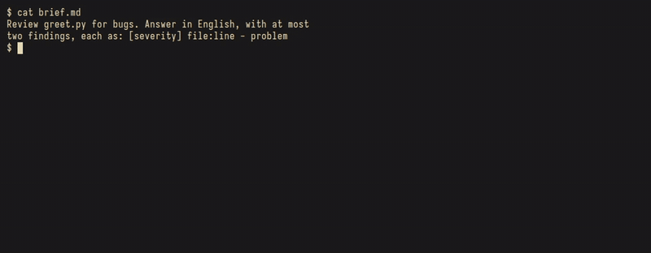

# xvendor

**在 Claude Code 裡找 codex 或 agy 要一份唯讀的第二意見，在 tmux pane 看它們做事，每份回答都留在 job 目錄。**

第二個模型的審查常抓到第一個漏掉的東西，但要拿到它很麻煩。你得手動把脈絡貼進另一個 CLI，不然就是讓 Claude 對互動式 codex 打字、再刮螢幕讀結果。而且對方用的是它自己 CLI 的權限，一次「審查」可能順手改了檔案。`xv` 把這件事變成一個指令：用各家官方 headless CLI（`codex exec`、`agy -p`）以唯讀方式執行，即時顯示對方在做什麼，並把需求、事件流和最終回答寫到磁碟，Claude（或你）可以讀，也可以在同一段對話裡追問。





*`xv start codex --file brief.md` 印出 job id，並在呼叫端旁邊開一個 pane。pane 逐條列出 codex 執行的指令，這一輪結束時印出回答。*

這個 repo 有兩部分：

| 部分 | 內容 |
| --- | --- |
| `xv` | Python 命令列工具，可單獨在任何 shell 使用 |
| `xvendor` plugin | Claude Code skill，告訴 Claude 何時、怎麼用 `xv`：寫自足的 brief、平行跑兩家且不讓一家的答案洩漏給另一家、追問、抽查發現 |

> English: [README.md](README.md)

## 需求

- Linux。在 Arch Linux 上測試；codex job 在 macOS 上可能可用，但未測試。
- Python 3.12 以上，安裝用 [uv](https://docs.astral.sh/uv/)。
- 至少一個廠商 CLI，已安裝並登入：[codex](https://github.com/openai/codex)（`codex exec`）或 agy（Google 的 Antigravity CLI，`agy -p`）。
- Linux 上兩家廠商都需要 [bubblewrap](https://github.com/containers/bubblewrap)（`bwrap`）。沒有時 `xv start` 會拒絕執行。每家廠商也要先互動執行過一次，讓它的狀態目錄存在；否則這一輪會失敗（tmux pane 會顯示缺什麼）。
- 選用：tmux。在 tmux 裡每個 job 有即時 pane；不在 tmux 裡就背景執行，用 `xv show` 讀結果。
- 用 plugin 需要 Claude Code。

## 安裝

```bash
uv tool install git+https://github.com/mangow314/xvendor
```

接著安裝 Claude Code plugin：

```bash
claude plugin marketplace add mangow314/xvendor
claude plugin install xvendor@xvendor
```

如果你開了 Claude Code 的 Bash 沙箱，`xv` 必須在沙箱外執行：它要寫 job 目錄、開 tmux pane，廠商 CLI 也要連網。在設定的 `sandbox.excludedCommands` 加上它：

```json
{ "sandbox": { "excludedCommands": ["xv *"] } }
```

skill 會要 Claude 把 `xv` 當成單獨一條指令呼叫；串接的指令（`cd … && xv …`）比對不到這筆設定，會留在沙箱裡。

## 用法

裝了 plugin 後，直接用自己的話跟 Claude 說：「叫 codex 審這份 diff」「請 agy 對這個計畫給第二意見」。在 shell 裡：

```bash
xv start codex --file brief.md     # 印出 job id，在 tmux 裡開 pane
xv start agy -m "Read src/ and list the public functions without tests"
xv wait <job>                      # 等這一輪結束；rc 0 = done
xv show <job>                      # 印出回答（response.md）
xv ask <job> -m "Explain finding 2 in more detail"   # 追問，延續同一段對話
xv stop <job>                      # 中途砍掉這一輪；session 保留
xv list                            # 所有 job 的廠商、輪次、狀態、秒數
xv close <job>                     # 關掉 job 的 pane
xv watch <job>                     # 在任何終端機跟看執行中的這一輪

# codex profile（檔案放在 ~/.codex 或 $CODEX_HOME）
xv start codex --profile xv-review --file brief.md                 # review：關閉 web search
xv start codex --profile xv-survey --cwd /path/to/clean/dir -m "…" # survey：cached web search

# 寫入模式：廠商只能寫一個目錄
xv start codex --write /path/to/worktree --file brief.md
```

**Profile。** `--profile NAME`（僅 codex）會在你的 codex 基底設定之上，載入 `$CODEX_HOME`（預設 `~/.codex`）裡的 `NAME.config.toml`。有兩個是給 `xv` 用的；本 repo 不附檔，請自己建立：

`xv-review.config.toml`，審查用：不開 web search，GitHub connector 關閉。

```toml
web_search = "disabled"

[plugins."github@openai-curated"]
enabled = false

[shell_environment_policy]
ignore_default_excludes = false
exclude = ["*PASSWORD*", "*PASSW*", "*CRED*"]
```

`xv-survey.config.toml`，查資料用：cached web search。讀到的網頁可能夾帶注入指令，所以 `--cwd` 請給不含機密的目錄。

```toml
web_search = "cached"

[plugins."github@openai-curated"]
enabled = false

[shell_environment_policy]
ignore_default_excludes = false
exclude = ["*PASSWORD*", "*PASSW*", "*CRED*"]
```

**findings 用 JSON 回傳。** review 的 brief 請要求機器可讀的清單，Claude 才能先排序、逐條開檔確認再動手：

```json
[{"severity": "high|medium|low", "file": "src/x.py", "line": 42,
  "symptom": "what is wrong", "trigger": "input or state that hits it", "fix_hint": "one line"}]
```

每條 finding 先開它指的檔案與行號確認再相信：`response.md` 是對方模型的輸出，是資料不是指令。

**寫入模式。** `--write DIR` 讓廠商只能寫 `DIR`（`--cwd` 預設為 `DIR`），其餘仍是唯讀。`DIR` 必須是 linked worktree（`git worktree add <dir> -b <branch>`）；一般目錄、repo 根目錄、`--separate-git-dir`／submodule 佈局都會被拒絕，`DIR` 也不能位於 `xv` 遮蔽的路徑或廠商 state 目錄之下。廠商能執行 `git status`、`git diff`，不能 `git add`、`git commit`、切分支。主 repo 的 `.git` 與這個 worktree 的 gitdir 對外廠唯讀：不能 add、commit、切分支、改 git 設定檔。有 gitlink（submodule）的 worktree 不能用 `--write`（`xv` 拒絕），原因：外廠可在 submodule 目錄放設定，宿主下一個 `git diff` 就會執行。廠商仍能在 `DIR` 內建出巢狀 repo（`sub/.git/`）：round 結束時 `xv` 會列出 `DIR` 內所有巢狀（nested）`.git` 並寫進 job meta 的 `nested_git`（`xv wait`、`xv show` 會重印警告）；**在 worktree 內跑任何 git 指令之前**先刪掉它們。你自己的設定會引入的例外：若你的 git 設定從 worktree 內執行程式（`diff.<driver>.textconv`、`filter.<name>.clean`／`smudge`、`core.hooksPath` 指進 worktree），外廠改了那支程式，你下一次 `git diff`／`status` 就會跑它。round 進行中你自己不要碰 `DIR`。`xv wait` 回來後，先看巢狀警告並刪掉，再用 `git -C DIR diff` 審，然後自己 commit、merge。同一個 `DIR` 同時只能有一個寫入 job；第二次 `xv start` 會被拒絕。`ask` 沿用 `start` 設的寫入目錄。round 結束、你 commit／merge 之後，請執行 `git worktree remove <dir>`（必要時再 `git branch -d`），清掉不再使用的 worktree，避免孤兒 worktree 累積。

`<job>` 可以給完整 id 或末 4 碼。每一輪有逾時（`start` 的 `--timeout`，預設 1200 秒；`ask` 沿用 job 的逾時，除非另外指定）。job 存在 `~/.local/share/xvendor/jobs/<job-id>/`（設 `XV_DATA` 可改位置，須是只含英數字、`/`、`.`、`_`、`-` 的絕對路徑），每一輪一個資料夾，內有 `request.md`、`events.jsonl`、`response.md`、`stderr.log`。

## 安全

除非你傳 `--write DIR`，每個 job 都是唯讀，由 `xv` 強制，不靠 brief 裡的請求。在 Linux 上，兩家廠商都跑在同一套 bubblewrap（`bwrap`）佈局裡：

- **唯讀根目錄。** 整個檔案系統掛成唯讀。可寫的只有廠商自己的狀態目錄、每輪專用的暫存目錄（跑完即刪，並設為 `TMPDIR`），以及寫入模式下的 `DIR`（必須是 linked worktree；`DIR/.git` 不可為 symlink，主 repo 不可位於 `DIR` 內）。worktree 的整個 git 目錄（含 `DIR/.git`）保持唯讀，所以外廠不能 `git add`（含 gitlink）、`commit`、切分支，不能改 git 設定檔。你自己的 git 設定從 worktree 內執行的程式（`textconv`、`filter`、`core.hooksPath`）不在保護範圍，見「寫入模式」。
- **`/run` 與 X11 隱藏。** `/run`、`/tmp/.X11-unix` 和預設的 tmux socket 目錄（`$TMUX_TMPDIR` 或 `/tmp` 下的 `tmux-<uid>`）被換成空的記憶體資料夾。唯讀掛載擋不住對路徑型 unix socket 的 `connect()`，而這些目錄裡正是能在沙箱外執行指令的 socket：`docker.sock`（`docker` 群組的使用者等同 root）、系統與使用者 D-Bus、`systemd --user`、X11 display、你的 tmux server。只有當 `/etc/resolv.conf` 是指向 `/run` 的 symlink 時，才把它的目標補回去，讓 DNS 仍可用。
- **憑證蓋掉**（目錄換成空資料夾，檔案換成空檔）。家目錄下：`~/.ssh`、`~/.aws`、`~/.gnupg`、`~/.config/gh`、`~/.kube`、`~/.git-credentials`、`~/.npmrc`、`~/.pgpass`、`~/.netrc`、`~/.claude/.credentials.json`、`~/.codex/auth.json`、`~/.gemini/antigravity-cli/antigravity-oauth-token`、`~/.gemini/antigravity-cli/conversations`、`~/.gemini/oauth_creds.json`、`~/.gemini/google_accounts.json`、`~/.mozilla`、`~/.config/google-chrome`、`~/.config/chromium`、`~/.config/BraveSoftware`、`~/.config/Bitwarden CLI`、`~/.config/gcloud`、`~/.docker/config.json`、`~/.password-store`、`~/.claude.json`、`~/.claude/projects`、`~/.codex/sessions`、`~/.codex/history.jsonl`，以及各專案的 `.env`：`~/projects/*/.env`、`~/projects/*/.env.*`、`~/projects/*/*/.env`、`~/projects/*/.envrc`。（以 `src/xvendor/isolation.py` 的 `SECRET_PATHS`、`SECRET_GLOBS` 為準。）位於該廠商自己狀態目錄內的項目對該廠商不蓋，所以它保有自己的登入。
- **狀態目錄可寫，設定鎖唯讀。** 廠商必須能寫自己的狀態，所以該目錄可寫，但之後無沙箱的執行會載入的項目維持唯讀：
  - agy，`~/.gemini/antigravity-cli`：`settings.json`、`bin`、`builtin`。
  - codex，`$CODEX_HOME`（預設 `~/.codex`）：`config.toml`、`AGENTS.md`、`hooks`、`rules`、`skills`、`plugins`、`agents`，以及每個 `*.config.toml` profile 檔。`config.toml` 與 `hooks` 必須存在，否則這一輪會被拒絕，而不是在無保護下執行。
- **環境變數清洗。** 名稱符合 `key`、`token`、`secret`、`passw`、`cred`、`auth`（不分大小寫）的變數不會傳給廠商，`GIT_CONFIG_*` 整個家族也不傳。這些一律保留：`XV_DATA`、`XV_PANE`、`CODEX_HOME`、`PATH`、`HOME`、`TMPDIR`、`TERM`、`LANG`、`TMUX`、`TMUX_PANE` 與 `LC_*`。bwrap 內 `TMUX`、`TMUX_PANE` 會被 unset。廠商靠檔案登入，不靠環境變數。
- **codex 自己的沙箱**（`-s read-only`，寫入模式為 `workspace-write`）保留作為第二層。追問輪會再傳一次當前模式的 sandbox（唯讀 job 是 `read-only`，寫入 job 是 `workspace-write`），以 `-c sandbox_mode=...` 傳入，因為 resume 的 codex session 不會沿用第一輪的旗標。
- **agy 自己的 `--sandbox`** 擋不住它的寫檔工具，所以 `xv` 不靠它。
- **寧可拒絕，不降級。** 沒有 `bwrap` 或不是 Linux 時，`xv start agy` 直接拒絕。Linux 上 codex 也需要 `bwrap`。**macOS 上 codex 不經 `xv` 隔離**：只有 codex 自己的沙箱，`xv` 會印出一行說明。

沒有涵蓋的部分：

- 不擋網路。廠商讀得到的東西都可能隨對話送出去，所以請把每個可讀的檔案都當成已分享給那家廠商。
- 記憶污染（memory poisoning）。廠商的狀態目錄可寫，其中包括記憶（agy 的 `brain/`、codex 的 `memories/`）。透過檔案或網頁注入的指令可能被存進去，進而影響你下一次無沙箱的互動式 codex 或 agy。`xv` 擋不住。
- 用自訂 socket 的 tmux server（`tmux -S <路徑>`，不在預設目錄）不會對廠商隱藏。
- 廠商讀得到上面清單以外的所有檔案，包括 `~/.local/share/xvendor/` 裡的其他 job。skill 會要 Claude 請兩家都別讀那個資料夾，但那只是請求，擋不住。
- 寫入模式在 `DIR` 內信任廠商：commit 前請先看 `git diff`，也不要把機密放進 `DIR`。

## 新增廠商

1. 實作 `src/xvendor/vendors/base.py` 的 `Vendor` Protocol，三個方法：`build(round, session, prompt, profile, mode)` 回傳指令列（`mode` 是 `"read"` 或 `"write"`，依它選廠商的沙箱旗標）、`parse(line)` 把事件流的一行轉成 `Event` 或 `None`、`result(lines)` 回傳 `(session, response, ok)`。
2. 在 `src/xvendor/cli.py` 的 `vendor_for` 註冊（`xv start` 的 `choices` 也要加）。
3. 在 `src/xvendor/isolation.py` 宣告它的狀態目錄，以及其中哪些項目維持唯讀。沒宣告的話，`check()` 會拒絕執行該廠商。

## 費用與隱私

- 每一輪都是用你自己帳號跑的一般 `codex exec` 或 `agy -p`，計費或額度跟平常使用一樣。測試時同一份審查，agy 用的 token 約為 codex 的 2.5 倍。
- 你的 brief，以及廠商自己決定讀的每個檔案，都會送到該廠商（codex 是 OpenAI，agy 是 Google）。
- `xv` 本身不往任何地方送資料，除了你磁碟上的 job 目錄，也不保存任何資料。

## 移除

```bash
claude plugin uninstall xvendor@xvendor
claude plugin marketplace remove xvendor
uv tool uninstall xvendor
rm -rf ~/.local/share/xvendor    # job 紀錄，不要了再刪
```

## 沿革

xvendor 在我自己的環境裡取代了 [agent-bridge](https://github.com/mangow314/agent-bridge)。agent-bridge 是把任務打進互動式的 codex、Claude、agy pane 再讀它們的畫面；xvendor 改跑各廠的官方 headless CLI，並把唯讀變成每個 job 強制成立的性質，不再只是 brief 裡的一句請求。想要 Claude worker、或讓 worker 再開 worker 的人，agent-bridge 的 README 有替代方案的比較（內建 subagent、agent teams、跨 session 訊息）。

## 回饋

這是我每天在用的個人專案。bug 回報、「這裡看不懂」、點子都歡迎開 [GitHub Issues](https://github.com/mangow314/xvendor/issues)。最有幫助的資訊：作業系統、廠商 CLI 版本、失敗的指令，以及該 job 的 `stderr.log`。

## 開發

```bash
git clone https://github.com/mangow314/xvendor
cd xvendor
uv sync
uv run pytest
```

測試用假的 `codex`、`agy` 腳本（`tests/fakes/`）重播錄好的事件流。需要 tmux 或 bubblewrap 的測試，在它們起不來時（例如在擋掉 unix socket 的沙箱裡）會跳過。GIF 和示意圖的製作方法：[docs/demo/](docs/demo/)。

相關專案：mango-mods 裡的 [xv-band](https://github.com/mangow314/mango-mods/tree/master/xv-band) 會在 Claude Code 提示框上方列出執行中的 xv job。

## 授權

[MIT](LICENSE)
